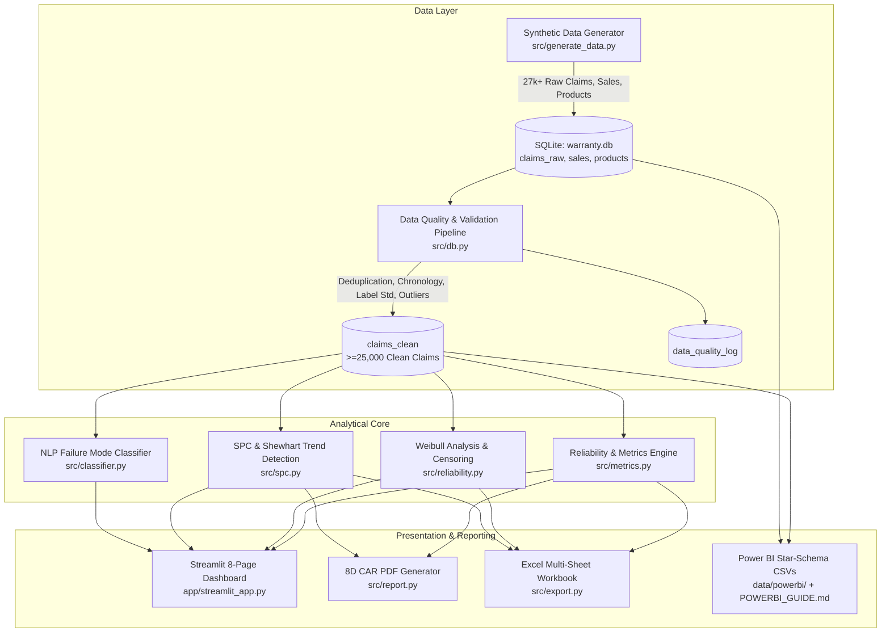

# Implementation Plan: Warranty Analytics & Reliability Dashboard

**Author:** Senior Reliability & Data Engineer  
**Project:** Warranty Analytics & Reliability Dashboard  
**Status:** In Progress  

---

## 1. Executive Summary & Architecture

This project replicates the end-to-end analytics workflow of a Reliability & Quality Engineer at an electrical equipment manufacturer (industrial UPS, switchgear, switchboards, and protection units). The platform provides automated ingestion, data quality validation, warranty liability accruals, Statistical Process Control (SPC), Weibull life data analysis (with right-censoring), NLP text classification of unstructured warranty claim notes, automated 8D Corrective Action Request (CAR) PDF generation, multi-tab Excel reporting, and Power BI star-schema export.

---

## 2. Hard Requirements Compliance Matrix

| Requirement | Target Specification | Design Decision |
| :--- | :--- | :--- |
| **Product Families** | Exactly **8** electrical families | 1. Online UPS 10kVA 2. Line-Interactive UPS 1kVA 3. Modular Industrial UPS 50kVA 4. LV Switchgear Panel 5. Molded Case Circuit Breaker (MCCB) 6. Air Circuit Breaker (ACB) 7. Surge Protection Device (SPD) 8. Power Distribution Unit (PDU) |
| **Failure Modes** | Exactly **12** distinct failure modes | 1. Capacitor Aging 2. Overheating / Fan Failure 3. Battery Degradation 4. Firmware Fault 5. PCB Solder Defect 6. Contact Wear 7. Insulation Breakdown 8. Loose Connection / Overheating 9. Trip-Unit Malfunction 10. Corrosion 11. MOV Varistor Degradation 12. Relay / Contactor Failure |
| **Clean Claims Count** | **$\ge$ 25,000** records after cleaning | Generate ~27,200 raw claims; after dropping ~200 duplicates and fixing bad dates/anomalies, retain ~26,000+ clean claims |
| **Synthetic Provenance** | Prominent synthetic declaration | Strictly synthetic generation using seed 42. Never claim real company data, Minitab, or ReliaSoft. |

---

## 3. Planted Failure Stories (Physics-of-Failure)

1. **Emerging Quality Issue (Supplier Defect):**
   - **Product:** Online UPS 10kVA
   - **Failure Mode:** Capacitor Aging (DC Bus Filter Capacitor)
   - **Planted Batch:** `LOT-CAP-2024-Q3`
   - **Mechanism:** Defective electrolyte seal from secondary capacitor supplier causes premature electrolyte dry-out under nominal operating temperature within 4-8 months. PPM spikes 4.5x in the last 4 months (reaching >20,000 PPM vs baseline ~3,500 PPM).
2. **Chronic Top Issue (High Financial Severity):**
   - **Product:** Air Circuit Breaker (ACB)
   - **Failure Mode:** Contact Wear (Main Arcing Contacts)
   - **Mechanism:** Heavy industrial switching duty cycles with harmonic distortion drive cumulative contact erosion. Represents >22% of all corporate warranty expenses due to high replacement parts cost ($1,200-$1,800/unit).
3. **Regional Environmental Issue (Atmospheric Stress):**
   - **Region:** South India (Coastal marine industrial zone: Chennai, Kochi, Vizag)
   - **Product:** LV Switchgear Panel & ACB
   - **Failure Mode:** Corrosion
   - **Mechanism:** Combination of ambient humidity (>85% RH) and industrial airborne sulfur/chlorides accelerates galvanic corrosion and copper sulfidation on unplated busbar joints and enclosure latches. Corrosion PPM is 3.5x higher in South India than in dry inland regions.

---

## 4. Module Implementation Breakdown

### Module 1: Synthetic Data Generator (`src/generate_data.py`)
- Products: Exactly 8 families with unit price, warranty months (12-36), target PPM.
- Sales: 36 monthly cohorts (2023-01 to 2025-12) x 8 products x 5 regions = 1,440 batches (~420,000+ total units shipped).
- Claims: ~27,200 raw claims generated via Weibull time-to-failure (infant mortality $\beta < 1$, random $\beta \approx 1$, wear-out $\beta > 1$).
- Planted noise: ~200 duplicate claims, ~120 invalid dates (`claim_date < ship_date`), ~600 label casing/synonym variations, ~30 cost outliers/negatives, ~400 null values, realistic text noise and overlapping technician symptoms.

### Module 2: Database & Data Quality Engine (`src/db.py`)
- SQLite schema with foreign keys, indexes, and automated audit logging in `data_quality_log`.
- Pipeline removes duplicates, rectifies chronological inversions, winsorizes cost outliers, maps failure modes to canonical 12-item ontology, imputes missing values, and materializes `claims_clean` table ($\ge 25,000$ rows) and analytical views.

### Module 3: Metrics Computation (`src/metrics.py`)
- PPM (Parts Per Million) overall, by product family, by region, by shipment cohort.
- CPU (Cost Per Unit) warranty spend per unit shipped.
- Warranty Accruals (rolling 12M CPU $\times$ units in active warranty minus claims paid).
- Pareto analysis (80/20 count and cost breakdown with cumulative percentage).
- Unit tests in `tests/test_metrics.py` against small hand-computed fixtures.

### Module 4: Weibull Reliability & Life Data Analysis (`src/reliability.py`)
- Fits 2-parameter Weibull distribution ($\beta$ shape, $\eta$ scale) using `lifelines.WeibullFitter`.
- Proper right-censoring: units shipped with no warranty claims are right-censored at end of observation window.
- Calculates $B_{10}$ life (time at which 10% of units are expected to fail), Mean Time To Failure (MTTF), and classifies failure regime:
  - $\beta < 1.0$: Infant Mortality / Early Life Quality Defect
  - $1.0 \le \beta \le 1.2$: Random Failures (Exponential hazard)
  - $\beta > 1.2$: Wear-out / Degradation
- Produces Weibull probability plot data and failure rate curves $h(t)$.

### Module 5: Statistical Process Control & Trend Detection (`src/spc.py`)
- Computes monthly cohort PPM for all failure modes and product families.
- Computes Shewhart control limits: Centerline ($\bar{X}$ / $\mu$), Upper Control Limit ($\text{UCL} = \mu + 3\sigma$), Upper Warning Limit ($\text{UWL} = \mu + 2\sigma$).
- Flags recent 3-month cohorts exceeding limits and automatically identifies the planted emerging capacitor lot.

### Module 6: NLP Failure Mode Classifier (`src/classifier.py`)
- TF-IDF Vectorizer with n-grams (1, 2) and sublinear scaling.
- Benchmarks Logistic Regression vs LinearSVC vs Multinomial Naive Bayes using 5-fold cross-validation.
- Evaluates on a stratified 15% hold-out test set; reports honest macro-F1 (~85-92%) reflecting real technician phrasing ambiguity.
- Serializes model to `models/failure_mode_pipeline.joblib` and writes metrics to `reports/metrics.json`.

### Module 7: PPIT / CAR 8D PDF Generator (`src/report.py`)
- Generates an executive 8D (Eight Disciplines) Corrective Action Request PDF using ReportLab:
  - D1: Team & Champion
  - D2: Problem Description & Field Symptoms
  - D3: Interim Containment Action (ICA)
  - D4: Root Cause Analysis (5-Why & Fishbone summary)
  - D5: Permanent Corrective Action (PCA)
  - D6: Validation & Verification
  - D7: Preventive Action
  - D8: Closure & KPI Sign-off
- Formatted with structured tables, severity badges, and signature blocks.

### Module 8: Multi-Sheet Excel Summary Workbook (`src/export.py`)
- Uses `openpyxl` to build `reports/warranty_summary.xlsx` with professional headers, styles, formatting, and auto-adjusted columns across 6 dedicated sheets:
  1. `Executive Summary`: High-level KPIs, PPM, CPU, Accruals
  2. `Top N Pareto`: Failure mode & component frequency and cost
  3. `PPM by Product`: Monthly cohort PPM time-series
  4. `Weibull Reliability`: $\beta$, $\eta$, $B_{10}$, and failure regime
  5. `PPIT CAR Ranking`: Ranked priority table with risk scores
  6. `Data Quality Audit`: DQ summary and audit log

### Module 9: Power BI Star-Schema & Guide (`data/powerbi/` & `POWERBI_GUIDE.md`)
- Generates 5 clean CSVs ready for Power BI Desktop:
  - `fact_claims.csv`
  - `fact_sales.csv`
  - `dim_product.csv`
  - `dim_region.csv`
  - `dim_date.csv`
- Authors `POWERBI_GUIDE.md` detailing step-by-step import instructions, 1-to-many relationship mappings, and copy-paste DAX formulas for PPM, CPU, Warranty Accruals, and Pareto cumulative %.

### Module 10: Streamlit Dashboard (`app/streamlit_app.py` + pages/)
- Modern multi-page application with 8 pages:
  1. `1_Executive_Overview.py`
  2. `2_Top_N_and_Pareto.py`
  3. `3_PPM_and_CPU_Trends.py`
  4. `4_Emerging_Issues.py`
  5. `5_Reliability_Analysis.py`
  6. `6_Failure_Mode_Classifier.py`
  7. `7_PPIT_CAR_Tracker.py`
  8. `8_Data_Quality.py`
- Global filter sidebar, Plotly interactive charts, direct 8D PDF generation download, Excel download, and CSV data export buttons.

### Module 11: Testing, Verification & Final Documentation
- Comprehensive pytest suite covering metrics, database cleaning, Weibull fitting, SPC control charts, and NLP inference.
- `README.md`, `RESUME_NUMBERS.md`, `Makefile`, and `run.sh` / `run.bat`.
- Verification of all acceptance criteria.
