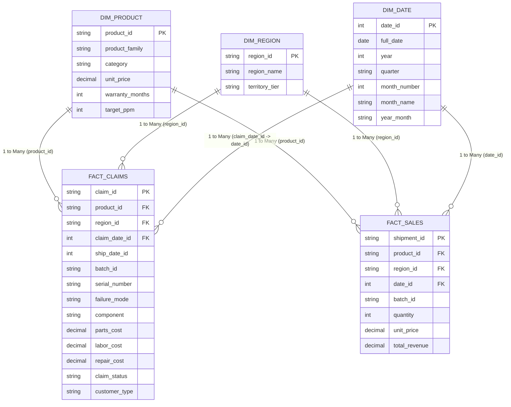

# Power BI Desktop Integration Guide: Warranty Analytics

This guide provides step-by-step instructions for importing the generated star-schema tables into **Power BI Desktop**, configuring relationships, creating calculated DAX measures, and constructing the executive warranty dashboard.

> [!NOTE]
> This guide is an implementation manual for Power BI Desktop. The underlying data model is exported into `data/powerbi/` as 5 clean CSV files (`fact_claims.csv`, `fact_sales.csv`, `dim_product.csv`, `dim_region.csv`, and `dim_date.csv`). No `.pbix` file is generated programmatically.

---

## 1. Data Model Architecture (Star Schema)

The star-schema architecture separates dimensional attributes from transactional event tables, optimizing DAX calculation performance:



---

## 2. Step-by-Step Data Import in Power BI Desktop

1. Launch **Power BI Desktop**.
2. Click **Get Data** > **Text/CSV**.
3. Navigate to `<project_root>/data/powerbi/` and import all 5 CSV files:
   - `dim_product.csv`
   - `dim_region.csv`
   - `dim_date.csv`
   - `fact_sales.csv`
   - `fact_claims.csv`
4. In **Power Query Editor**, verify data types:
   - `date_id`, `claim_date_id`, `ship_date_id`: Integer
   - `repair_cost`, `parts_cost`, `labor_cost`, `unit_price`, `total_revenue`: Fixed Decimal Number (Currency)
   - `quantity`: Whole Number
   - `full_date`: Date
5. Click **Close & Apply**.
6. Switch to the **Model View** tab and configure the following 1-to-Many (`1:*`), Single Cross-Filter relationships:
   - `dim_product[product_id]` $\rightarrow$ `fact_claims[product_id]`
   - `dim_product[product_id]` $\rightarrow$ `fact_sales[product_id]`
   - `dim_region[region_id]` $\rightarrow$ `fact_claims[region_id]`
   - `dim_region[region_id]` $\rightarrow$ `fact_sales[region_id]`
   - `dim_date[date_id]` $\rightarrow$ `fact_claims[claim_date_id]` (Active)
   - `dim_date[date_id]` $\rightarrow$ `fact_sales[date_id]` (Active)

---

## 3. Core DAX Measures (Copy & Paste)

Create a dedicated table called `_Measures` and insert the following DAX calculations:

### 3.1 Base Volume & Cost Measures
```dax
Total Claims = 
COUNTROWS(fact_claims)

Total Units Shipped = 
SUM(fact_sales[quantity])

Total Warranty Cost = 
SUM(fact_claims[repair_cost])

Total Revenue = 
SUM(fact_sales[total_revenue])
```

### 3.2 Parts Per Million (PPM)
```dax
PPM = 
DIVIDE([Total Claims], [Total Units Shipped], 0) * 1000000

PPM Target = 
AVERAGE(dim_product[target_ppm])
```

### 3.3 Cost Per Unit (CPU)
```dax
CPU = 
DIVIDE([Total Warranty Cost], [Total Units Shipped], 0)

Warranty Cost Pct of Revenue = 
DIVIDE([Total Warranty Cost], [Total Revenue], 0)
```

### 3.4 Rolling 12-Month CPU
```dax
Rolling 12M CPU = 
VAR LastDateSelected = MAX(dim_date[full_date])
VAR FirstDate12M = EDATE(LastDateSelected, -12)
VAR RollingClaimsCost = 
    CALCULATE(
        [Total Warranty Cost],
        DATESBETWEEN(dim_date[full_date], FirstDate12M, LastDateSelected)
    )
VAR RollingShippedQty = 
    CALCULATE(
        [Total Units Shipped],
        DATESBETWEEN(dim_date[full_date], FirstDate12M, LastDateSelected)
    )
RETURN
    DIVIDE(RollingClaimsCost, RollingShippedQty, 0)
```

### 3.5 Estimated Warranty Liability (Accruals)
```dax
Warranty Accruals = 
VAR ActiveLiability = 
    SUMX(
        VALUES(dim_product[product_family]),
        VAR ProdCPU = [Rolling 12M CPU]
        VAR WarrantyMonths = SELECTEDVALUE(dim_product[warranty_months], 24)
        VAR CurrentDate = MAX(dim_date[full_date])
        VAR ActiveCutoffDate = EDATE(CurrentDate, -WarrantyMonths)
        VAR ActiveShippedUnits = 
            CALCULATE(
                [Total Units Shipped],
                dim_date[full_date] >= ActiveCutoffDate
            )
        VAR PaidClaimsOnActive = 
            CALCULATE(
                [Total Warranty Cost],
                dim_date[full_date] >= ActiveCutoffDate
            )
        VAR ExpectedExpense = ActiveShippedUnits * ProdCPU
        RETURN
            MAX(0, ExpectedExpense - PaidClaimsOnActive)
    )
RETURN
    ActiveLiability
```

### 3.6 Pareto Cumulative % (Failure Mode)
```dax
Pareto Cumulative Claims Pct = 
VAR CurrentClaims = [Total Claims]
VAR AllClaims = CALCULATE([Total Claims], ALLSELECTED(fact_claims[failure_mode]))
VAR CumulativeClaims = 
    CALCULATE(
        [Total Claims],
        FILTER(
            ALLSELECTED(fact_claims[failure_mode]),
            [Total Claims] >= CurrentClaims
        )
    )
RETURN
    DIVIDE(CumulativeClaims, AllClaims, 0)
```

### 3.7 Statistical Process Control (2-Sigma Upper Warning Limit)
```dax
UWL 2Sigma PPM = 
VAR MeanPPM = [PPM]
VAR P_Bar = DIVIDE([Total Claims], [Total Units Shipped], 0)
VAR AvgUnitsPerMonth = AVERAGE(fact_sales[quantity])
VAR Sigma = SQRT(DIVIDE(P_Bar * (1 - P_Bar), AvgUnitsPerMonth, 0)) * 1000000
RETURN
    MeanPPM + (2 * Sigma)
```

---

## 4. Recommended Report Visualizations

| Visual Title | Visual Type | Fields / Measures | Formatting / Insight |
| :--- | :--- | :--- | :--- |
| **Executive KPIs** | Card Visuals | `[Total Claims]`, `[PPM]`, `[CPU]`, `[Warranty Accruals]` | Callout value, bold font, formatted currency |
| **PPM vs Target by Family** | Clustered Bar Chart | Y-Axis: `dim_product[product_family]`<br/>X-Axis: `[PPM]`, `[PPM Target]` | Conditional formatting: Red if `[PPM] > [PPM Target]` |
| **Failure Mode Pareto** | Line & Clustered Column | X-Axis: `fact_claims[failure_mode]`<br/>Column Y: `[Total Claims]`<br/>Line Y: `[Pareto Cumulative Claims Pct]` | 80% reference threshold line |
| **Monthly Trend & Control Bands** | Line Chart | X-Axis: `dim_date[year_month]`<br/>Y-Axis: `[PPM]`, `[UWL 2Sigma PPM]` | Identifies recent spikes above 2-sigma |
| **Regional Geographic Heatmap** | Filled Map / Matrix | Rows: `dim_region[region_name]`<br/>Values: `[Total Claims]`, `[PPM]`, `[Total Warranty Cost]` | Shows coastal corrosion concentration in South India |
| **PPIT Action Table** | Table / Matrix | Product, Failure Mode, Claims, Cost, Trend Shift, CAR Status | Highlight items qualifying for 8D CAR |
