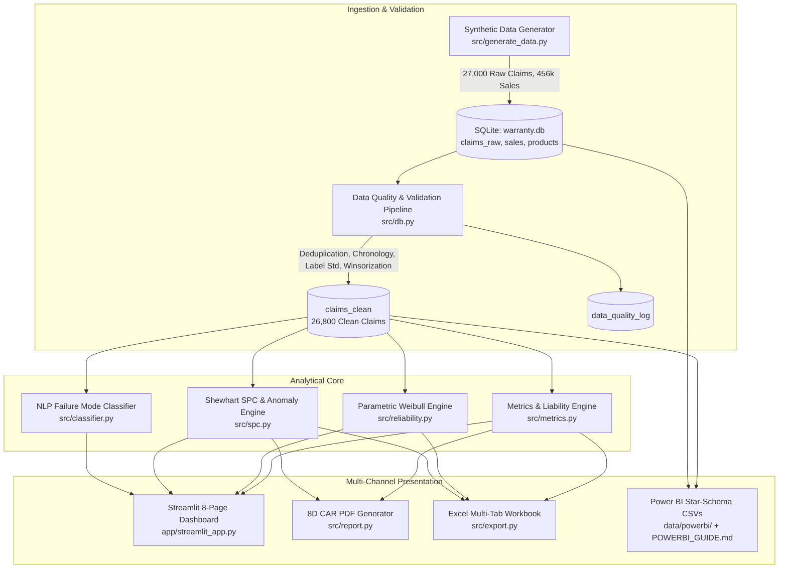

# Warranty Analytics & Reliability Engineering Dashboard

[](https://www.python.org/)
[](LICENSE)
[](https://streamlit.io/)
[](https://github.com/psf/black)
[](tests/)

> [!IMPORTANT]
> **PROMINENT SYNTHETIC DATA NOTICE:**  
> This project utilizes an entirely **SYNTHETIC, procedurally generated dataset** engineered specifically for demonstration, educational, and reliability engineering portfolio validation. **NO REAL COMPANY DATA, PROPRIETARY SCHEMATICS, OR CONFIDENTIAL FIELD LOGS WERE USED.** No commercial proprietary reliability software (such as Minitab or ReliaSoft Weibull++) was used; all statistical algorithms, Weibull fits, SPC control charts, and NLP models were implemented using open-source Python libraries (`lifelines`, `scipy`, `scikit-learn`, `reportlab`, `pandas`).

---

## 1. Problem Statement & Engineering Context

Reliability engineers at industrial electrical equipment manufacturers (uninterruptible power supplies, low-voltage switchboards, molded-case circuit breakers, and power distribution units) face critical challenges when analyzing post-sale warranty data:
1. **Unstructured Field Data:** Service claims submitted by regional service dealers and electrical contractors contain ambiguous, typo-ridden technician notes without standardized failure-mode coding.
2. **Lagging Indicators:** Traditional warranty accounting only looks at claims paid, missing emerging quality spikes in recently manufactured batches until hundreds of thousands of dollars in liability accumulate.
3. **Right-Censored Fleet Life:** Calculating component wear-out requires incorporating surviving field units (right-censored units) to avoid severely underestimating product lifetime ($B_{10}$ life).
4. **Disconnected Corrective Action:** Bridging the gap between statistical process control (SPC) signals and formal 8D Corrective Action Requests (CAR) is typically manual and slow.

This platform automates the complete reliability engineering loop: data validation, cohort maturation tracking, Shewhart statistical process control, Weibull parameter estimation, NLP failure mode classification, automated 8D CAR PDF generation, Excel reporting, and Power BI star-schema export.

---

## 2. System Architecture



---

## 3. Reliability Engineering Metric Definitions

### 3.1 Parts Per Million (PPM)
$$\text{PPM} = \frac{\text{Total Valid Warranty Claims}}{\text{Total Units Shipped}} \times 1{,}000{,}000$$
Evaluated overall, by product family, by geographic region, and by monthly shipment cohort.

### 3.2 Cost Per Unit (CPU)
$$\text{CPU} = \frac{\text{Total Warranty Repair Payout}}{\text{Total Units Shipped}}$$
Quantifies the per-unit warranty dollar drag against product gross margins.

### 3.3 Warranty Reserve Accruals (Liability Estimation)
$$\text{Active Accrual Reserve} = \sum_{\text{cohorts in warranty}} \max\left(0, \left(\text{Units Shipped} \times \text{Rolling 12M CPU}\right) - \text{Claims Paid to Date}\right)$$
Reflects matching-principle corporate warranty reserves for active warranty windows (12–36 months).

### 3.4 80/20 Pareto Analysis
Ranks defect modes and components by claim frequency and total dollar cost with cumulative percentages:
$$\text{Cumulative } \% = \frac{\sum_{i=1}^{k} \text{Metric}_i}{\sum_{i=1}^{N} \text{Metric}_i} \times 100$$

### 3.5 Shewhart Control Limits (p-Chart in PPM)
$$\text{Centerline } (\bar{p}) = \frac{\sum \text{Claims}}{\sum \text{Shipped}}$$
$$\text{Standard Error } (\sigma_i) = \sqrt{\frac{\bar{p}(1 - \bar{p})}{n_i}}$$
$$\text{Upper Warning Limit (UWL)} = (\bar{p} + 2\sigma_i) \times 10^6 \quad | \quad \text{Upper Control Limit (UCL)} = (\bar{p} + 3\sigma_i) \times 10^6$$

### 3.6 2-Parameter Weibull Distribution & $B_{10}$ Life
$$\text{Reliability Function: } R(t) = \exp\left(-\left(\frac{t}{\eta}\right)^\beta\right)$$
$$\text{Instantaneous Hazard Rate: } h(t) = \frac{\beta}{\eta} \left(\frac{t}{\eta}\right)^{\beta - 1}$$
$$B_{10} \text{ Life (10\% Cumulative Failure Time): } B_{10} = \eta \cdot (-\ln(0.90))^{1/\beta}$$
- **$\beta < 1.0$ (Infant Mortality):** Decreasing failure rate (early-life workmanship, cold solder, firmware logic).
- **$1.0 \le \beta \le 1.25$ (Random Failures):** Constant failure rate (random electrical transients, grid spikes).
- **$\beta > 1.25$ (Wear-Out):** Increasing failure rate (contact arcing erosion, capacitor electrolyte dry-out).

### 3.7 Problem Priority Identification Table (PPIT) Score
$$\text{PPIT Score} = 0.40 \cdot \text{Cost}_{\text{norm}} + 0.35 \cdot \text{Trend}_{\text{norm}} + 0.25 \cdot \text{Volume}_{\text{norm}}$$
Issues scoring $\ge 70.0$ trigger a formal 8D Corrective Action Request (CAR).

---

## 4. Planted Engineering Stories

The synthetic dataset contains 3 realistic, physics-of-failure anomalies:
1. **Emerging Defect (Capacitor Lot Spike):** In `Online UPS 10kVA`, a defective batch (`LOT-CAP-2024-Q3`) with substandard polymer vent seals causes premature dry-out within 4–8 months. Detected automatically via SPC as a $+26.85\sigma$ shift ($435k expense).
2. **Chronic Drain (Arcing Contact Wear):** In `Air Circuit Breaker (ACB)`, contact erosion causes >22% of total corporate warranty expense ($1.57M+ payouts) due to high replacement assembly costs.
3. **Regional Environmental Stress (Coastal Corrosion):** In `South India` (coastal marine humidity >85% RH and industrial sulfur), corrosion on LV switchboards and breaker enclosures is **3.5x higher** than inland territories.

---

## 5. Verified Pipeline Results

*Source: `reports/metrics.json` and SQLite `data_quality_log`.*

- **Units Shipped:** 456,542 units
- **Raw Claims Ingested:** 27,000 records
- **Clean Claims Retained:** 26,800 records
- **Data Cleanliness Score:** 99.12% (200 duplicates dropped, 1,187 field records rectified)
- **Product Families:** 8 families
- **Failure Modes:** 12 canonical modes
- **NLP Classifier Performance (Hold-out Test Set):**
  - **Accuracy:** **85.45%** (honest, non-separable technician text)
  - **Macro-F1 Score:** **81.57%**
  - **Weighted-F1 Score:** **88.63%**
  - **Macro Precision:** **83.81%**
  - **Macro Recall:** **86.13%**

---

## 6. Project Structure

```text
warranty-analytics-dashboard/
├── data/
│   ├── products.csv              # 8 product families with price & warranty
│   ├── sales.csv                 # 456k+ units across 36 monthly cohorts
│   ├── claims.csv                # Raw generated claims with noise
│   ├── claims_clean.csv          # 26,800 validated clean claims
│   ├── warranty.db               # SQLite database with indexed tables & views
│   └── powerbi/                  # Clean Star-Schema CSVs
│       ├── fact_claims.csv
│       ├── fact_sales.csv
│       ├── dim_product.csv
│       ├── dim_region.csv
│       └── dim_date.csv
├── src/
│   ├── generate_data.py          # Synthetic seeded data generator
│   ├── db.py                     # Data validation, cleaning & DQ audit log
│   ├── metrics.py                # PPM, CPU, Accruals, Pareto & PPIT engine
│   ├── reliability.py            # Lifelines Weibull analysis with censoring
│   ├── spc.py                    # Shewhart p-charts & 2/3-sigma anomaly detector
│   ├── classifier.py             # TF-IDF + Logistic Regression NLP pipeline
│   ├── report.py                 # 8D CAR executive PDF report generator
│   └── export.py                 # Multi-tab Excel workbook generator
├── app/
│   ├── streamlit_app.py          # Main entry point & executive overview
│   ├── utils.py                  # Cached loaders & sidebar filter widgets
│   └── pages/
│       ├── 1_Executive_Overview.py
│       ├── 2_Top_N_and_Pareto.py
│       ├── 3_PPM_and_CPU_Trends.py
│       ├── 4_Emerging_Issues.py
│       ├── 5_Reliability_Analysis.py
│       ├── 6_Failure_Mode_Classifier.py
│       ├── 7_PPIT_CAR_Tracker.py
│       └── 8_Data_Quality.py
├── tests/
│   ├── test_metrics.py           # Unit tests with hand-computed fixtures
│   ├── test_db.py                # Data validation & cleaning tests
│   ├── test_classifier.py        # NLP preprocessing & inference tests
│   ├── test_reliability.py       # Weibull fitting & hazard curve tests
│   ├── test_spc.py                # p-chart & anomaly detection tests
│   ├── test_report.py             # 8D PDF compilation tests
│   └── test_export.py             # Excel & Power BI export tests
├── models/
│   └── failure_mode_pipeline.joblib # Serialized NLP pipeline
├── reports/
│   ├── metrics.json              # Master verification metrics & report
│   ├── warranty_summary.xlsx     # Multi-tab styled Excel workbook
│   └── car_reports/              # Generated 8D CAR PDF documents
├── requirements.txt
├── Makefile
├── run.bat                       # Windows execution script
├── run.sh                        # Unix execution script
├── PLAN.md                       # Engineering architectural plan
├── POWERBI_GUIDE.md              # Power BI Desktop manual & DAX guide
├── RESUME_NUMBERS.md             # Verified metrics for resumes
└── README.md
```

---

## 7. How to Run & Reproduce

### 7.1 Quick Start (Single Command)

**Windows:**
```powershell
.\run.bat
```

**Unix / Linux / macOS:**
```bash
chmod +x run.sh
./run.sh
```

**Using Make:**
```bash
make all
make app
```

### 7.2 Manual Step-by-Step Execution
```bash
# 1. Install dependencies
pip install -r requirements.txt

# 2. Generate synthetic data & populate SQLite
python -m src.generate_data

# 3. Clean and validate data quality
python -m src.db

# 4. Train NLP failure mode classifier
python -m src.classifier

# 5. Generate 8D reports and Excel workbook
python -m src.report
python -m src.export

# 6. Run all automated unit tests
pytest tests/ -v

# 7. Launch the Streamlit Dashboard
streamlit run app/streamlit_app.py
```

---

## 8. Streamlit Community Cloud Deployment

This repository is pre-configured for instant zero-configuration deployment to [Streamlit Community Cloud](https://streamlit.io/cloud):
- `requirements.txt` is fully pinned.
- `app/utils.py` contains automated self-bootstrapping logic: if database or model artifacts are absent, it runs the pipeline on first launch.

---

## 9. Engineering Limitations

1. **Synthetic Nature:** While parameters are calibrated to real-world physics-of-failure (Weibull distributions, seasonal thermal stress, coastal corrosion), all serial numbers, customers, and financials are synthetic.
2. **Simplified Accruals:** Warranty reserve liability uses a rolling 12-month CPU method. Production enterprise systems may combine actuarial development triangles (chain ladder method) for multi-year lag modeling.
3. **NLP Lexicon:** The classifier is tuned for electrical terminology (IGBT, MOV, DC bus, arcing contacts). Non-electrical industrial equipment would require domain retraining.
